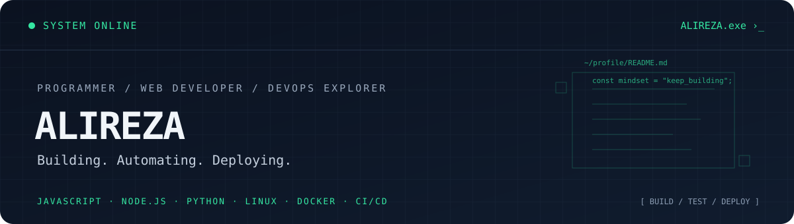

<div align="center">



<br/>

<a href="https://github.com/AlirezaM19999">
  
</a>
<a href="https://alireza-portfolio.businessman.workers.dev">
  
</a>
<a href="https://www.linkedin.com/in/alireza-m-054ab724b/">
  
</a>

<p>
  <strong>Programmer · Web Developer · DevOps Explorer</strong><br/>
  <em>Building useful things. Automating the boring parts. Learning by shipping.</em>
</p>

</div>

---

## `whoami`

I'm Alireza — a programmer interested in building practical web applications, developer tools, and reliable deployment workflows.

- 💻 I work with web technologies, backend logic, databases, and content-management platforms.
- 🐧 I use Linux and explore Docker, CI/CD, and infrastructure workflows through hands-on projects.
- 🧩 I enjoy connecting user-friendly interfaces with useful functionality.
- 🌱 I keep learning by building, debugging, documenting, and improving real projects.
- 🤝 Interested in thoughtful collaboration, open-source projects, and practical engineering challenges.

> **Current mindset:** write clear code, understand the system, document the work, improve one iteration at a time.

## `./tech-stack.sh`

### Web & Software

<p>
  
  
  
  
  
  
  
</p>

### Infrastructure & Workflow

<p>
  
  
  
  
  
  
</p>

### CMS, Design & Growth

<p>
  
  
  
  
  
</p>

## `ls ./projects`

<table>
  <tr>
    <td width="50%" valign="top">
      <h3>🗣️ AAC-Full</h3>
      <p>A mobile AAC communication app project focused on accessible communication workflows.</p>
      <p>
        
        
      </p>
      <a href="https://github.com/Ali1999rm/AAC-Full">View repository ↗</a>
    </td>
    <td width="50%" valign="top">
      <h3>🌐 Web & Network Utilities</h3>
      <p>Experiments and practical tools around web development, IP/network information, and browser-based utilities.</p>
      <p>
        
        
      </p>
      <a href="https://github.com/AlirezaM19999?tab=repositories">Explore repositories ↗</a>
    </td>
  </tr>
  <tr>
    <td width="50%" valign="top">
      <h3>🧭 Deepseek-rtl</h3>
      <p>A right-to-left interface experiment aimed at a more comfortable Persian-language web experience.</p>
      <p>
        
        
        
      </p>
      <a href="https://github.com/AlirezaM19999?tab=repositories">Find projects in repositories ↗</a>
    </td>
    <td width="50%" valign="top">
      <h3>☁️ Portfolio & Deployment</h3>
      <p>Personal portfolio hosted on Cloudflare, with a focus on presenting projects and development skills.</p>
      <p>
        
        
      </p>
      <a href="https://alireza-portfolio.businessman.workers.dev">Open portfolio ↗</a>
    </td>
  </tr>
</table>

## `./github-stats`

<div align="center">
  <a href="https://github.com/AlirezaM19999">
    
  </a>
  <a href="https://github.com/AlirezaM19999">
    
  </a>
</div>

<div align="center">
  
</div>

## `./connect.sh`

<div align="center">

<a href="https://github.com/AlirezaM19999">GitHub</a> ·
<a href="https://alireza-portfolio.businessman.workers.dev">Portfolio</a> ·
<a href="https://www.linkedin.com/in/alireza-m-054ab724b/">LinkedIn</a>

<br/>

```text
[ SYSTEM STATUS ]  LEARNING  /  BUILDING  /  DEPLOYING
```

<sub>Designed with a terminal mindset — focused on useful work, not just visual noise.</sub>

</div>
